# Project 00: Blocking X (Twitter) with the Windows hosts file

> [!NOTE]
> **Simulated Work.** I edited the Windows hosts file so that X (formerly Twitter) cannot load on my own laptop, flushed the DNS cache, and tested the block across several site names and three browsers. I then reversed the block and confirmed X loaded again.
>
> **Skills shown:** editing a protected system file as administrator, understanding how name lookup works on Windows, DNS cache management with `ipconfig`, and testing a change and its rollback.

## Scenario (Simulated Work)
A user asks IT support to stop a distracting website from loading on their PC, without installing any software. I used the hosts file, which Windows checks before it asks a DNS server, to point the site's names at the computer itself so the page never loads.

## Why this matters
Support staff are often asked to block a site on one machine, and the hosts file is the quickest built-in way to do it. It also teaches how a computer turns a website name into an address.

## Environment
- OS and edition: Windows 11 Pro
- Tested on: my own laptop (no work or client data used)
- Tools used: Notepad++ (run as administrator), PowerShell (run as administrator), Brave, Microsoft Edge and Google Chrome
- Names: computer and account names are real and left visible. Network identifiers (IPs, MAC addresses, Wi-Fi names) are redacted; none appear here. The profile picture in the Chrome screenshot is covered with a black box.

> [!NOTE]
> **How these screenshots were made:** I first set up the block on 29 October 2026. The screenshots were taken afterwards, during re-checks on 5 and 6 November 2026, so Steps 1 to 3 show the finished state, not the moment of editing.

## Background: how the hosts file works
When you type `x.com`, Windows needs an IP address for that name. It checks the **hosts file** first, and only asks a DNS server if the name is not listed there. Each line in the file is an IP address followed by a name. If I map a name to `127.0.0.1` (the loopback address, which always means "this computer"), the browser tries to connect to my own PC. Nothing is listening there, so the connection is refused.

---

# Part 1: Blocking the site

## Step 1: Open Notepad++ as administrator
- **Action:** right-click Notepad++ and choose **Run as administrator**.
- **Why:** the hosts file is protected. Windows only lets an editor save changes to it when the editor is running as administrator.
- **What I expected:** an editor window marked as administrator.
- **What happened:** the window title shows `Notepad++ [Administrator]`.

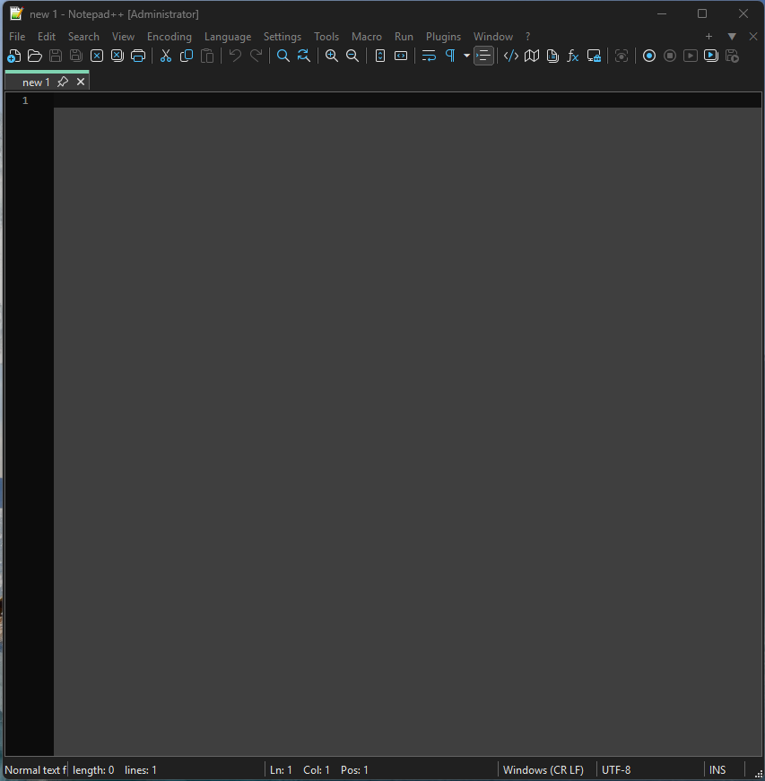

## Step 2: Open the hosts file
- **Action:** in Notepad++, **File > Open**, then browse to `C:\Windows\System32\drivers\etc`. Change the file type filter at the bottom to **All types**, select `hosts`, and click **Open**.
- **Why the filter:** the hosts file has no file extension, so the default filter can hide it.
- **What I expected:** a file named `hosts` in the `etc` folder.
- **What happened:** `hosts` is listed next to `lmhosts.sam`, `networks`, `protocol` and `services`, with the filter set to "All types".

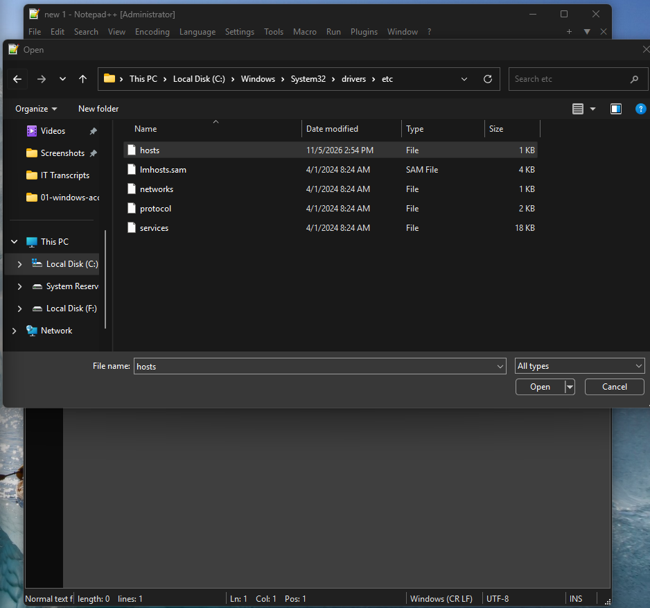

## Step 3: Add the block entries
Added these four lines at the bottom of the file, then saved it:
```text
127.0.0.1 x.com
127.0.0.1 www.x.com
127.0.0.1 twitter.com
127.0.0.1 www.twitter.com
```
- **What they do:** each line sends one name to `127.0.0.1`, my own computer. The hosts file matches exact names, so I added both the `x.com` and `twitter.com` names, with and without `www`.
- **What I expected:** the four lines below the default comments, with the file saved.
- **What happened:** lines 23 to 26 hold the four entries. The file shows 26 lines.
- **Note:** the two example IP addresses in the comments (lines 16 and 17) are part of Microsoft's default file, not mine.

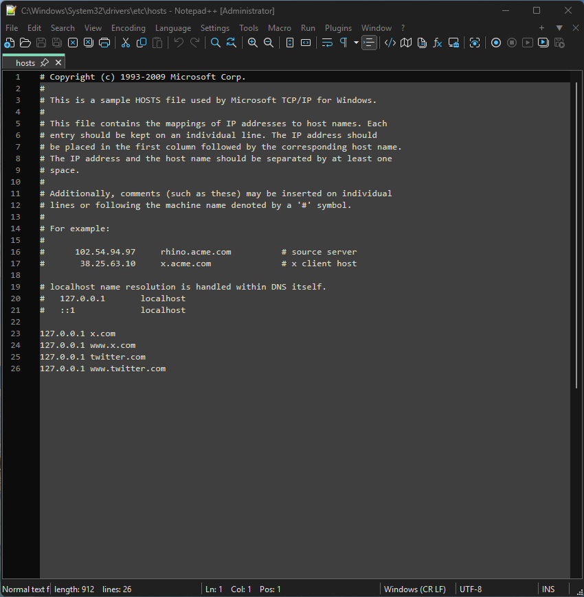

## Step 4: Flush the DNS cache
In PowerShell run as administrator:
```powershell
ipconfig /flushdns
```
- **What it does:** clears the list of names and addresses Windows has remembered, so it does not keep using an old address for `x.com`.
- **What I expected:** a message that the cache was cleared.
- **What happened:** "Successfully flushed the DNS Resolver Cache."

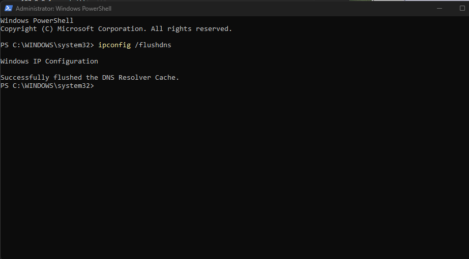

## Step 5: First test, `x.com` in Brave
- **Action:** opened `x.com` in Brave.
- **What I expected:** the page fails to load.
- **What happened:** Brave showed "This site can't be reached" and "x.com refused to connect", with the error `ERR_CONNECTION_REFUSED`. That is the result I expected: the name now points at my own PC, and nothing there answers.

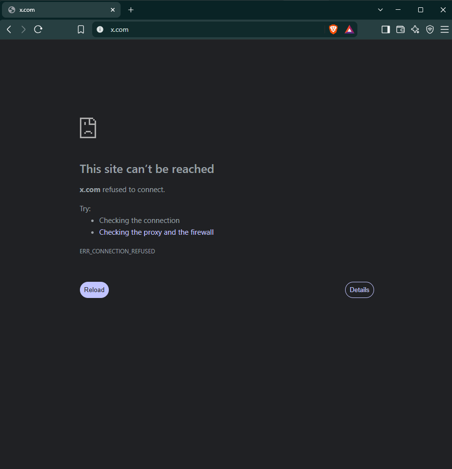

---

# Part 2: Testing the block

## Step 6: Test the other three names in Brave
- **Action:** opened `www.x.com`, `twitter.com` and `www.twitter.com` one at a time in Brave.
- **What I expected:** the same refused connection for each, because each name has its own line in the hosts file.
- **What happened:** all three showed `ERR_CONNECTION_REFUSED`.
- **Note:** Brave hides `www.` in the address bar. The tab title and the error message show the full name that was tested.

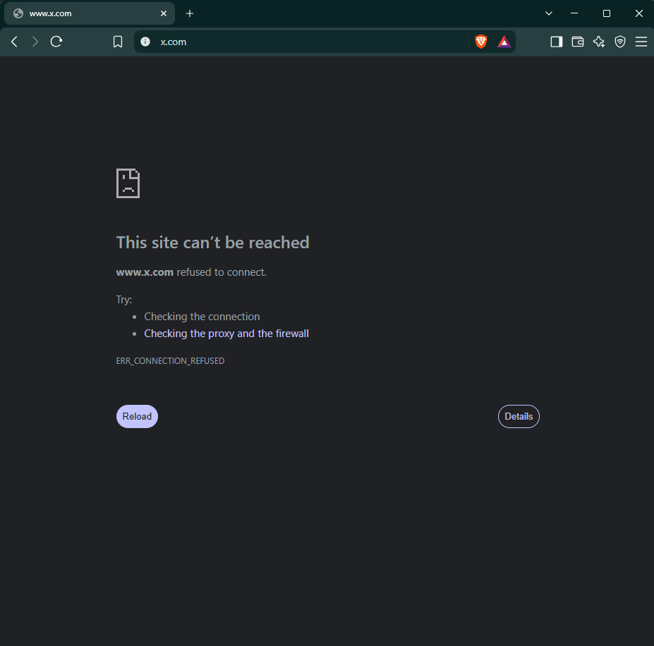

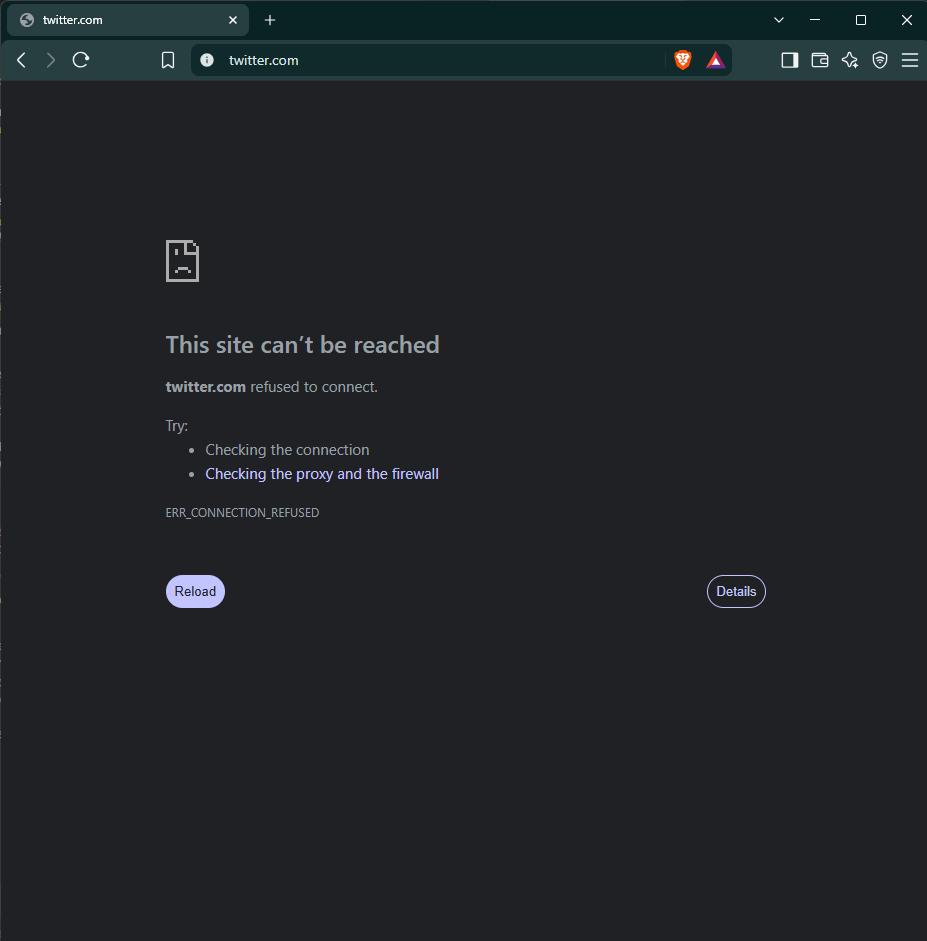

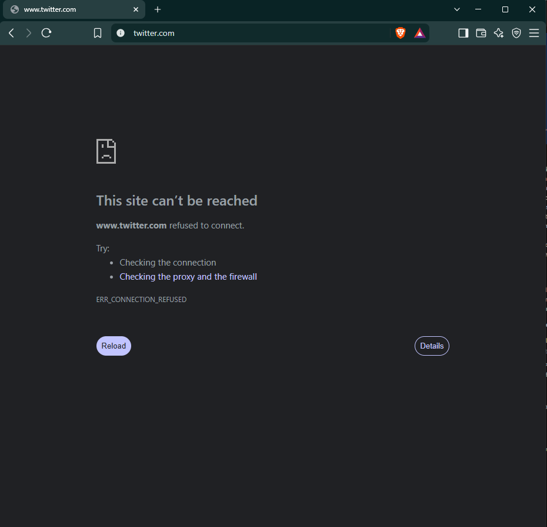

## Step 7: Test in Microsoft Edge and Google Chrome
- **Action:** opened `x.com` in Microsoft Edge, then in Google Chrome.
- **Why:** the hosts file is applied by Windows, not by one browser, so the block should work in every browser on this computer.
- **What I expected:** the same refused connection in both.
- **What happened:** both showed `ERR_CONNECTION_REFUSED`. The wording differs: Edge says "Hmmm... can't reach this page" and Chrome says "This site can't be reached", but the error code is the same.

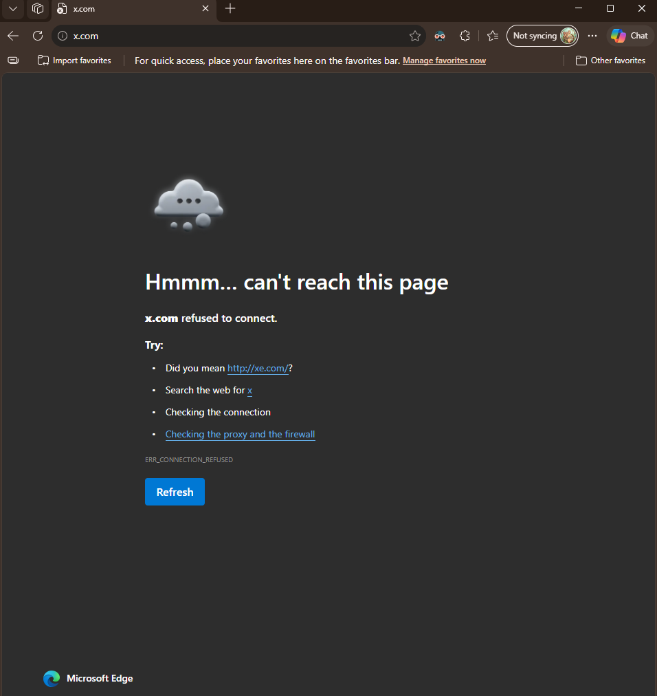

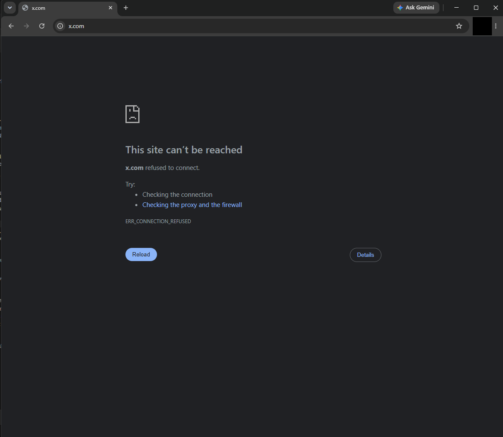

---

# Part 3: Restoring access

## Step 8: Turn off the block by commenting out the entries
- **Action:** reopened the hosts file in Notepad++ as administrator, added `#` at the start of each of the four lines, and saved.
- **Why `#`:** Windows ignores any line that starts with `#`, so the entries stay in the file but stop working. They are easy to turn back on later.
- **What I expected:** the four lines now start with `#`.
- **What happened:** lines 23 to 26 now start with `#`. The file length in the status bar went from 912 to 916 characters, which matches four added `#` characters.

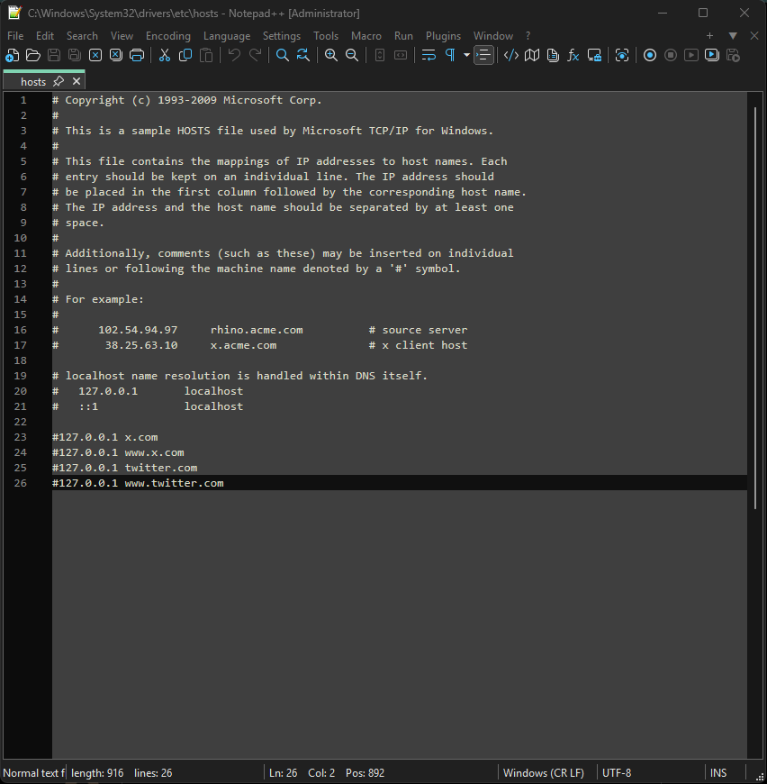

## Step 9: Flush the DNS cache again
Ran `ipconfig /flushdns` again in PowerShell as administrator, so Windows would stop using its remembered answers. I did not take a screenshot of this step.

## Step 10: Confirm X loads again
- **Action:** opened `x.com` in Brave.
- **What I expected:** the X page loads.
- **What happened:** X loaded and showed its sign-in page. I was not signed in, so no account details are shown.

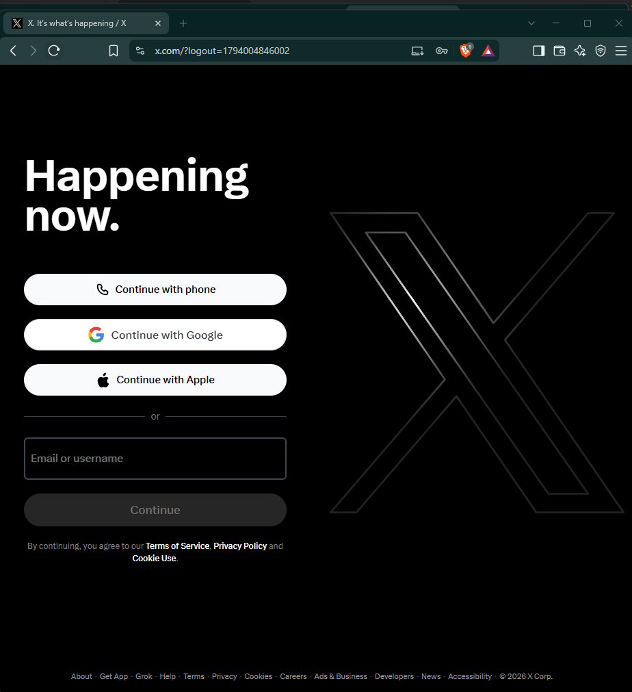

To block X again, remove the `#` from the start of each line, save, and run `ipconfig /flushdns`.

---

## Expected vs actual
| Test | Expected | Actual | Evidence |
|---|---|---|---|
| Open the hosts file in an editor run as administrator | File opens, window marked `[Administrator]` | Opened, title shows `[Administrator]` | Screenshot |
| Flush the DNS cache after adding the entries | Success message | "Successfully flushed the DNS Resolver Cache." | Screenshot |
| `x.com` in Brave | Page does not load | `ERR_CONNECTION_REFUSED` | Screenshot |
| `www.x.com` in Brave | Page does not load | `ERR_CONNECTION_REFUSED` | Screenshot |
| `twitter.com` in Brave | Page does not load | `ERR_CONNECTION_REFUSED` | Screenshot |
| `www.twitter.com` in Brave | Page does not load | `ERR_CONNECTION_REFUSED` | Screenshot |
| `x.com` in Microsoft Edge | Page does not load | `ERR_CONNECTION_REFUSED` | Screenshot |
| `x.com` in Google Chrome | Page does not load | `ERR_CONNECTION_REFUSED` | Screenshot |
| Comment out the four entries and save | Lines start with `#` | Lines 23 to 26 start with `#` | Screenshot |
| Flush the DNS cache after commenting out | Success message | Done | No screenshot |
| `x.com` in Brave after restoring | X loads | X sign-in page loaded | Screenshot |

## Problems I hit
None recorded for this task.

## What I could not test or verify
- **Before state:** I have no screenshot of X loading normally before I first added the block. The final screenshot shows access restored, not the original state.
- **Flush after restoring:** I ran `ipconfig /flushdns` again, but I did not capture it.
- **Restore in other browsers:** I confirmed X loading again in Brave only, not in Edge or Chrome.
- **Scope:** the block works on this one computer only. Other devices and the X mobile app are not affected.

## What I learned
- Windows checks the hosts file before it asks a DNS server, so a line there overrides the real address of a site.
- `127.0.0.1` means "this computer". Pointing a site there gives "connection refused", not a block page.
- The hosts file can only be saved by an editor running as administrator.
- The hosts file matches exact names, so `x.com` and `www.x.com` each need their own line.
- The block applies to every browser on the computer. Different browsers word the error differently, but the code (`ERR_CONNECTION_REFUSED`) is the same.
- Adding `#` in front of a line turns an entry off without deleting it, which makes the change easy to reverse.
- `ipconfig /flushdns` clears cached answers so a change takes effect straight away.

## Command cheat sheet
| Command or term | What it does |
|---|---|
| `C:\Windows\System32\drivers\etc\hosts` | The hosts file: a list of names and the addresses Windows should use for them |
| `127.0.0.1 name` | One hosts entry. The address comes first, then the name, separated by a space |
| `127.0.0.1` | Loopback address. It always means "this computer" |
| `#` | Starts a comment. Windows ignores the rest of that line, so `#` turns an entry off |
| `ipconfig /flushdns` | Clears Windows' cache of name-to-address answers |
| `ERR_CONNECTION_REFUSED` | Browser error: the address answered but nothing there accepted the connection |
| Run as administrator | Starts a program with rights to change protected files |

## Evidence checklist
- [x] Screenshots numbered, no spaces in file names, stored in `Attachments/`
- [x] No IPs, MAC addresses or Wi-Fi names appear in the screenshots
- [x] Browser profile picture covered in the Chrome screenshot
- [x] Commands and entries also written as text, not only in images
- [x] Steps without a screenshot, and untested items, recorded honestly
- [x] Computer and account names are real and left visible; network identifiers are redacted
- [x] Uploaded to GitHub folder
