# Project 1: Windows accounts and permissions

> [!NOTE]
> **Simulated Work.** I created a standard user, locked a folder so only administrators could open it, then granted read-only and later modify access. After each change I checked the result while signed in as that user.
>
> **Skills shown:** user and directory management, NTFS folder permissions with `icacls`, troubleshooting inherited permissions.

## Scenario (Simulated Work)
A new staff member (a standard user, "TestUser") needs read-only access to a restricted folder, and later needs permission to add files to it. I set up the folder, tested access as that user at each stage, and cleaned everything up afterwards.

## Why this matters
IT support staff regularly create accounts and decide who can read or change a shared folder. Too much access is a security risk. Too little stops people from doing their work.

## Environment
- OS and edition: Windows 11 Pro
- Tested on: my own laptop (no work or client data used)
- Tools used: PowerShell as administrator, and File Explorer (GUI)
- Restore point or backup taken before starting: yes
- Names: computer and account names are real and left visible. Network identifiers (IPs, MAC addresses, Wi-Fi names) are redacted; none appear in this project.

## Before / baseline
I listed the local accounts and the members of the Administrators group before changing anything.

```powershell
Get-LocalUser
Get-LocalGroupMember Administrators
```

- **What they do:** `Get-LocalUser` lists every local account and whether it is enabled. `Get-LocalGroupMember Administrators` shows who has administrator rights.
- **What I saw:** the built-in `Administrator` account is disabled (`Enabled False`), only two accounts are in the Administrators group, and `TestUser` does not exist yet.

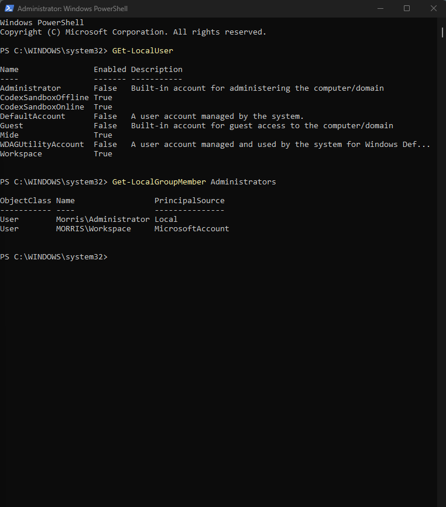

## Steps

### Step 1: Create a standard user
```powershell
net user TestUser * /add
net localgroup users
net localgroup administrators
```
- **What it does:**
  - `net user` is the older Windows command for managing accounts.
  - `*` makes Windows ask for the password with hidden typing, so it never appears on screen or in command history.
  - `/add` creates the account.
  - `net localgroup users` and `net localgroup administrators` list who is in each group, to check the new account's level of access.
- **What I expected:** a local account called `TestUser`, in the Users group but not in Administrators.
- **What happened:** "The command completed successfully." `TestUser` appears in the Users group and is not in the Administrators group.

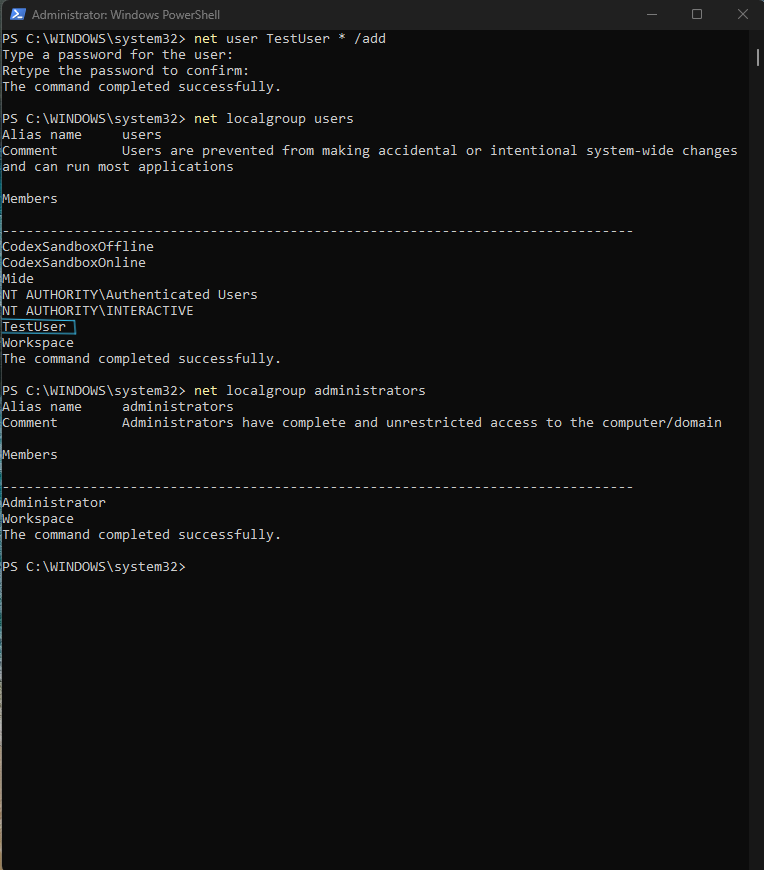

### Step 2: Create the locked folder and a test file
```powershell
mkdir C:\PortfolioTest\Shared
icacls 'C:\PortfolioTest\Shared' /grant 'Administrators:(OI)(CI)F'
icacls 'C:\PortfolioTest\Shared' /grant 'SYSTEM:(OI)(CI)F'
echo "test file" > C:\PortfolioTest\Shared\readme.txt
icacls 'C:\PortfolioTest\Shared'
icacls 'C:\PortfolioTest\Shared' /inheritance:r
icacls 'C:\PortfolioTest\Shared'
```
- **What it does:**
  - `mkdir` creates the folder `Shared` (and `PortfolioTest` above it).
  - `icacls` shows or changes a folder's permission list. `/grant` adds a permission entry.
  - `Administrators:(OI)(CI)F` gives full control (`F`) to administrators. `(OI)(CI)` means the permission also applies to files and subfolders created inside.
  - `SYSTEM` is the account Windows itself uses. It is given full control so the operating system can still manage the folder.
  - `echo "test file" > ...` prints the text, and `>` sends it into `readme.txt` instead of the screen.
  - Running `icacls` with only a path just lists the permissions.
  - `/inheritance:r` stops the folder inheriting permissions from its parent and removes the inherited entries.
- **What I expected:** a folder that only Administrators and SYSTEM can open, containing `readme.txt`.
- **What happened:** the folder and file were created. The first `icacls` listing showed inherited `(I)` entries for Users and Authenticated Users. After `/inheritance:r`, only SYSTEM and Administrators remained.
- **Note:** this screenshot also shows my first `echo` attempt failing (Problem 1) and the inherited entries that caused Problem 2.

> [!WARNING]
> Run `/inheritance:r` before you test as another user. A new folder inherits its parent's permissions, so without this step a standard user can still get in. See Problem 2.

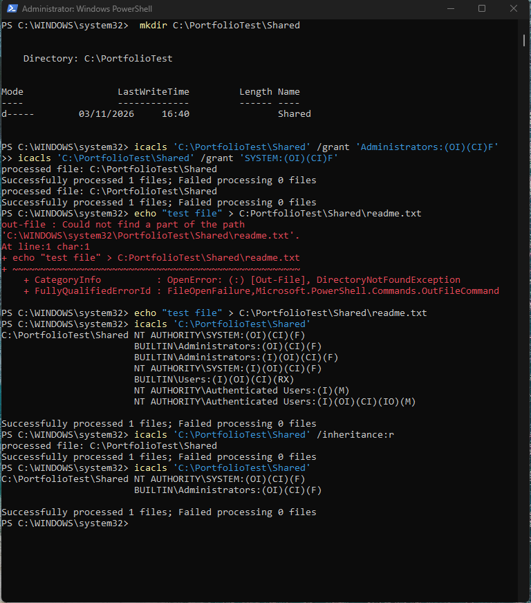

### Step 3: Confirm which account I am testing as
```powershell
whoami
```
- **What it does:** prints the account the current window is running as.
- **What I expected:** `morris\testuser`.
- **What happened:** the output was `morris\testuser`. This window is a normal (non-administrator) PowerShell session, so the tests that follow are done as TestUser, not as an administrator.

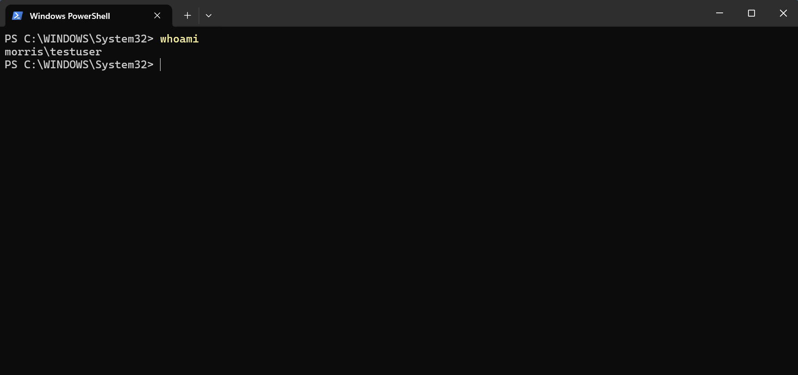

### Step 4: TestUser tries to open the locked folder
- **Action:** signed in as TestUser, opened File Explorer, browsed to `C:\PortfolioTest` and opened `Shared`.
- **What I expected:** access blocked.
- **What happened:** Windows blocked access with "You don't currently have permission to access this folder." The Continue button asks for administrator approval, which a standard user does not have.

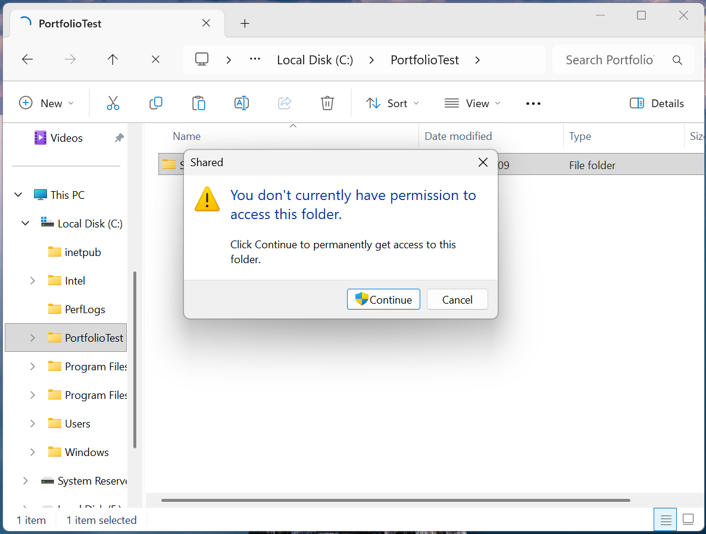

### Step 5: Grant read-only access
```powershell
icacls 'C:\PortfolioTest\Shared' /grant 'TestUser:(OI)(CI)(R)'
```
- **What it does:** adds a read (`R`) entry for TestUser. `/grant` adds to the existing permissions. `(OI)(CI)` applies it to files and subfolders inside.
- **What I expected:** TestUser can open the folder and read `readme.txt`, but cannot add anything.
- **What happened:**
  - TestUser opened `Shared` and opened `readme.txt`, which showed "test file".
  - Trying to create a new file in the folder was denied: Windows showed "Destination Folder Access Denied".
  - I typed in Notepad but did not save, so saving a change to `readme.txt` was not tested (see "What I could not test or verify").

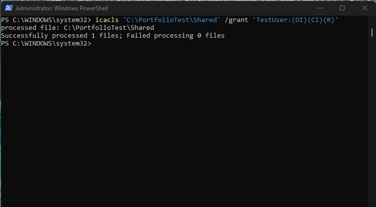

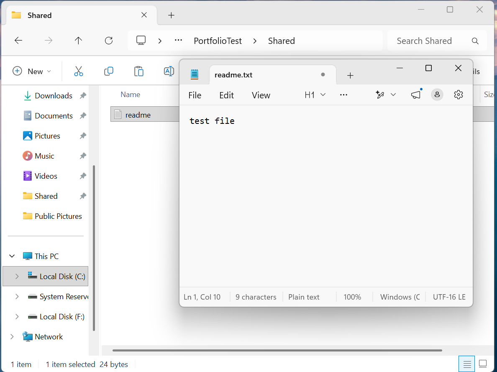

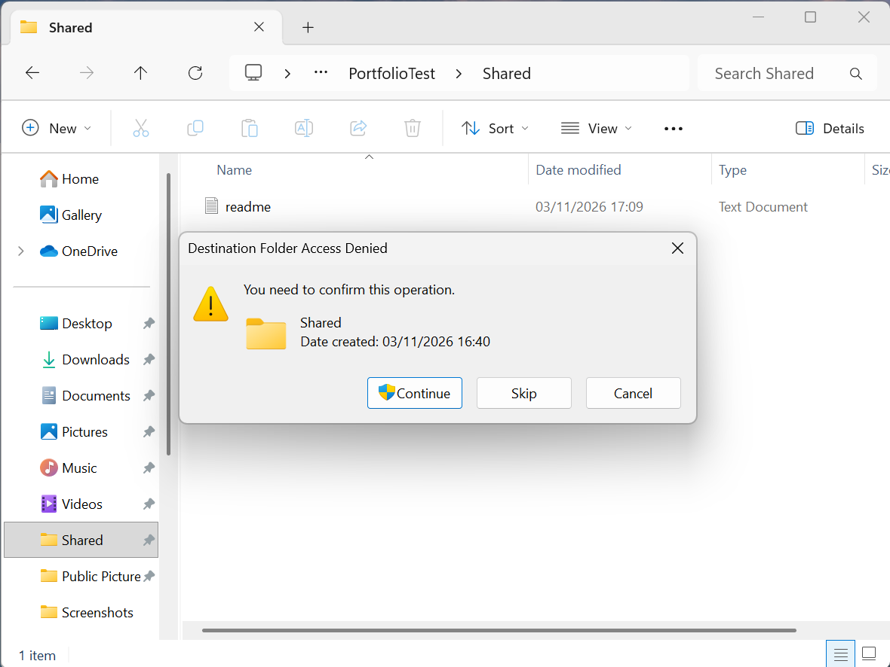

### Step 6: Grant modify access
```powershell
icacls 'C:\PortfolioTest\Shared' /grant:r 'TestUser:(OI)(CI)(M)'
```
- **What it does:** `/grant:r` replaces TestUser's existing entry (Read) with Modify (`M`: read, write, execute and delete). Administrators and SYSTEM are not affected.
- **What I expected:** TestUser can now add items to `Shared`.
- **What happened:** TestUser created a new folder inside `Shared`.

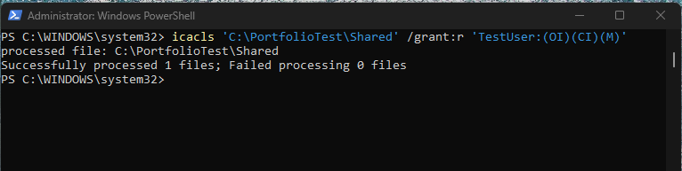

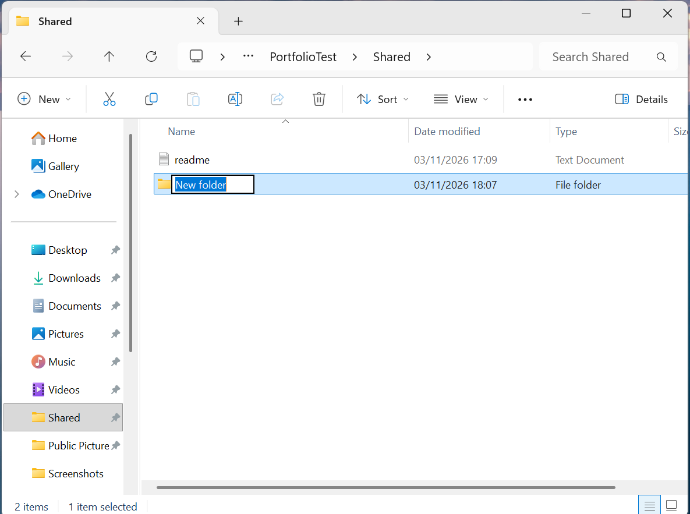

## Expected vs actual
| Test (as TestUser) | Expected | Actual | Tested? |
|---|---|---|---|
| Open `Shared` before any grant | Blocked | Blocked (administrator approval prompt) | yes |
| Open `Shared` after Read grant | Opens | Opened | yes |
| Open `readme.txt` after Read grant | Opens, content visible | Opened, showed "test file" | yes |
| Create a new file after Read grant | Denied | Denied ("Destination Folder Access Denied") | yes |
| Edit and save `readme.txt` after Read grant | Should be denied | Not tested (typed in Notepad, did not save) | no |
| Create a new folder after Modify grant | Allowed | Allowed | yes |

## Problems I hit

### Problem 1: Path typo
- **Symptom:** PowerShell returned a `DirectoryNotFoundException` when I tried to create `readme.txt` in the Shared folder.
- **Diagnosis:** the error message showed the path `C:\WINDOWS\system32\PortfolioTest\Shared\readme.txt`, not `C:\PortfolioTest\...`.
- **Cause:** I typed `C:PortfolioTest\Shared\readme.txt`, with no backslash after `C:`. Windows reads a drive letter without a backslash as relative to the current folder on that drive, which was `C:\WINDOWS\system32`.
- **Fix:** re-ran the command with `C:\PortfolioTest\Shared\readme.txt`.
- **Verified by:** the second command ran with no error, and I navigated to `C:\PortfolioTest\Shared` and confirmed `readme.txt` existed with the expected text.

### Problem 2: Standard user could open a folder meant to be admin-only
- **Symptom:** a standard user could open a folder that was meant to be admin-only.
- **Diagnosis:** `icacls` listed inherited `(I)` entries: `BUILTIN\Users:(I)(OI)(CI)(RX)` (Users can read and run) and `NT AUTHORITY\Authenticated Users:(I)(M)` (any signed-in user can modify).
- **Cause:** I skipped `/inheritance:r`, so the folder kept its parent's permissions.
- **Fix:** ran `/inheritance:r`, then ran `icacls` again and confirmed only SYSTEM and Administrators were listed.
- **Verified by:** signed in as TestUser and tried to open `Shared`. Access was blocked (Step 4).

## Cleanup
```powershell
net user TestUser /delete
Remove-Item -Recurse -Force C:\PortfolioTest
Get-LocalUser
Test-Path C:\PortfolioTest
```
- **What I removed:** the TestUser account and the `C:\PortfolioTest` folder with everything in it.
- **How I confirmed it was gone:** `Get-LocalUser` no longer lists TestUser, and `Test-Path C:\PortfolioTest` returned `False`.

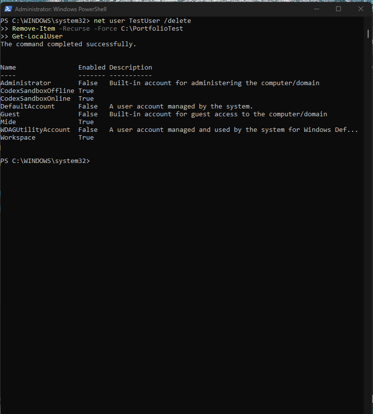

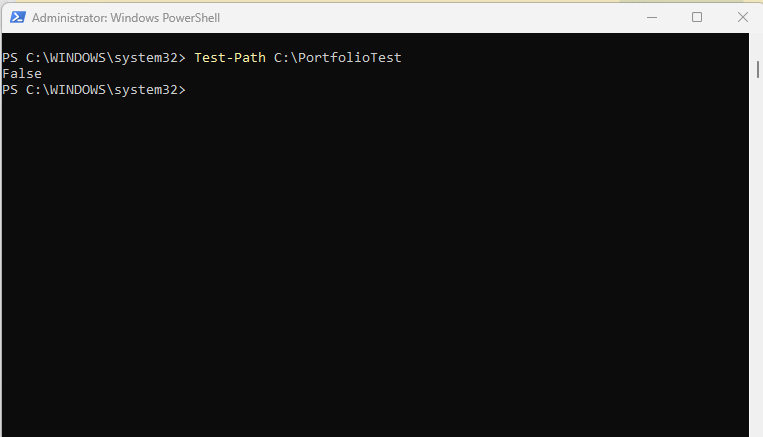

## What I could not test or verify
- **Saving an edit to `readme.txt` under Read-only access.** I typed in Notepad but did not save. Read access is confirmed, and creating a new file in the folder was denied. Whether Windows would block saving a change to the existing file is not verified. TestUser was deleted during cleanup, so I could not go back and check.
- **Scope:** only local accounts on one machine. 

## What I learned
- A new folder inherits its parent's permissions. Check with `icacls` before testing as another user, and use `/inheritance:r` to lock a folder down.
- `C:` and `C:\` are different. Without the backslash, Windows treats the path as relative to the current folder.
- `/grant` adds a permission. `/grant:r` replaces the user's existing entry.
- A standard user who is blocked may see an administrator approval prompt, not a plain "Access denied" message.
- Confirm which account you are testing as (`whoami`) before trusting a test result.
- Say clearly what was not tested, so nobody assumes more than the evidence shows.

## Command cheat sheet
| Command | What it does |
|---|---|
| `Get-LocalUser` | Lists every local account and whether it is enabled |
| `Get-LocalGroupMember Administrators` | Shows who is in the Administrators group |
| `net user <name> * /add` | Creates a local account. `*` asks for the password with hidden typing, `/add` creates the account |
| `net user <name> /delete` | Deletes the account |
| `net localgroup <group>` | Lists the members of a local group |
| `whoami` | Shows which account the current window is running as |
| `mkdir <path>` | Creates a folder (and any missing parent folders in PowerShell) |
| `echo "text" > file` | `echo` prints text. `>` sends it into a file instead of the screen (overwrites the file) |
| `icacls <path>` | Shows a folder's permission list |
| `/grant` | Adds a permission entry |
| `/grant:r` | Replaces the user's existing entry with the new one |
| `/inheritance:r` | Stops inheriting from the parent and removes the inherited entries |
| `(OI)(CI)` | Applies the permission to files (object inherit) and subfolders (container inherit) inside |
| `F`, `M`, `R` | Full control, Modify, Read |
| `Remove-Item -Recurse -Force <path>` | Deletes a folder and everything in it with no confirmation and no Recycle Bin, so double-check the path |
| `Test-Path <path>` | Returns `True` or `False` for whether a path exists |

## Evidence checklist
- [x] Screenshots numbered, no spaces in file names, stored in `Attachments/`
- [x] No IPs, MAC addresses or Wi-Fi names appear in the screenshots
- [x] Commands also written as text, not only in images
- [x] Problems and untested items recorded honestly
- [x] Computer and account names are real and left visible; network identifiers are redacted
- [ ] Uploaded to GitHub folder and linked from the main README
