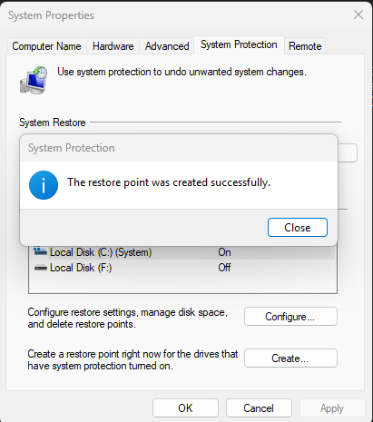
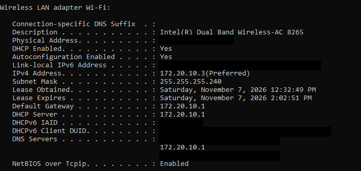
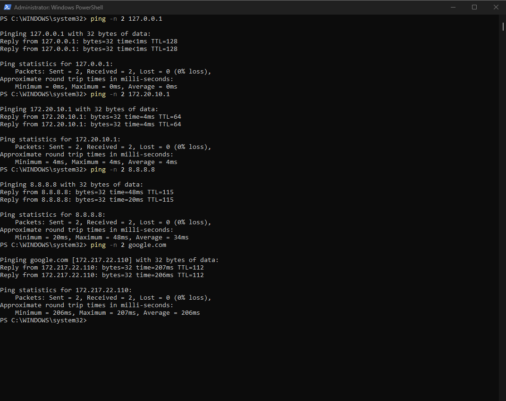
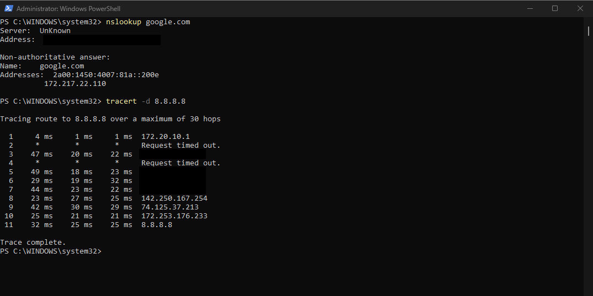
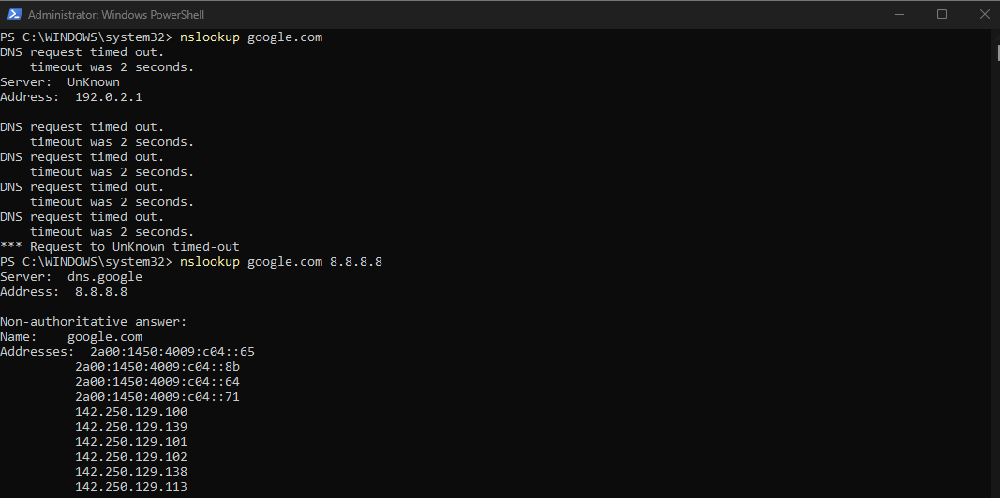
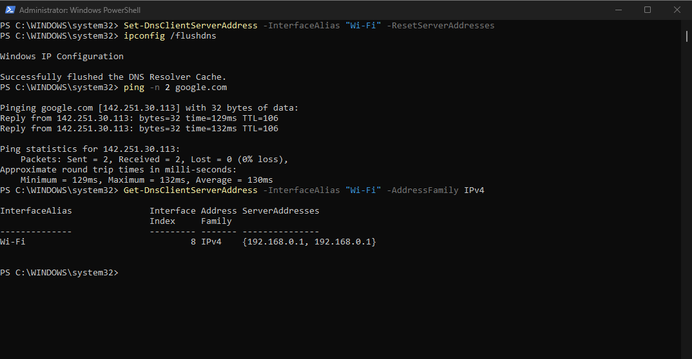
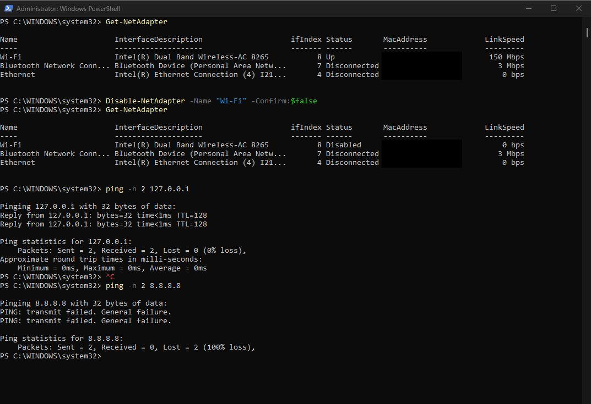
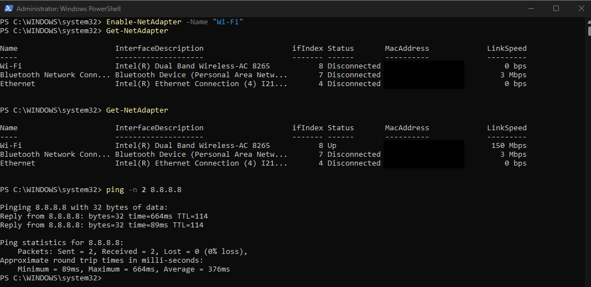

# Project 02: Network troubleshooting

> [!NOTE]
> **Simulated Work.** I checked a healthy network connection with command-line tools, then caused two common faults on my own laptop (a wrong DNS server, and a disabled network adapter). For each fault I diagnosed the cause from the command results, fixed it, and confirmed the fix.
>
> **Skills shown:** layered network troubleshooting, `ping`, `nslookup`, `tracert`, `ipconfig`, PowerShell network commands, and making and reversing a change safely.

## Scenario (Simulated Work)
Two support tickets:
1. "I can't open any website, but my internet seems to be connected."
2. "My laptop says there is no network at all."

I reproduced each problem, worked out the cause by testing one layer of the connection at a time, and restored normal service.

## Why this matters
Connection problems are among the most common support requests. A fixed order of tests finds the cause quickly and avoids guessing.

## Environment
- OS and edition: Windows 11 Pro
- Tested on: my own laptop (Intel Dual Band Wireless-AC 8265 Wi-Fi adapter). No work or client data used.
- Network: my phone's hotspot for the baseline, because my Wi-Fi was not working. I later switched to my MiFi (portable Wi-Fi) when electricity returned. See "What I could not test or verify".
- Tool used: PowerShell, run as administrator
- Safety: I created a restore point before changing anything, and each fault was reversed straight after testing.
- Redaction: computer and account names are real and left visible. MAC addresses and IPv6 addresses are covered with black boxes, and so are four hops in the route trace that sit inside my mobile carrier's network (private-range `10.x` addresses that are not mine to publish). Addresses on my own local network (`172.20.10.x`, `192.168.0.x`) are left visible because the diagnosis depends on them. Public addresses of well-known services such as Google's are also visible, since they identify nothing about me. My own public IP address never appears.

## The method: test from the bottom up
Each test proves one layer works before moving to the next. The first test that fails shows which layer is broken.

| Layer | Test | What it proves |
|---|---|---|
| 1. My own PC | `ping 127.0.0.1` | The network software on my PC works |
| 2. My connection to the router | `ping <default gateway>` | The link to the router works |
| 3. The internet | `ping 8.8.8.8` | I can reach the internet by address |
| 4. Name lookup (DNS) | `ping google.com`, `nslookup` | Names are turned into addresses |

---

# Part 1: Baseline (healthy connection)

## Step 1: Create a restore point
- **Action:** opened System Properties, System Protection, and created a restore point.
- **Why:** if a change goes wrong, Windows can return to this point.
- **What I expected:** a confirmation message.
- **What happened:** "The restore point was created successfully."



## Step 2: Record the network settings
```powershell
ipconfig /all
```
- **What it does:** shows the full network settings of every adapter.
- **What I expected:** an IPv4 address, subnet mask, default gateway, DHCP enabled and DNS servers for the Wi-Fi adapter.
- **What happened:**
  - The Wi-Fi adapter had IPv4 address `172.20.10.3` with subnet mask `255.255.255.240`.
  - The default gateway and DHCP server were both `172.20.10.1`.
  - DHCP was enabled, meaning the hotspot assigned the address automatically.
  - The MAC address, IPv6 addresses and DHCPv6 identifiers are covered.



## Step 3: Run the layered ping tests
```powershell
ping -n 2 127.0.0.1
ping -n 2 172.20.10.1
ping -n 2 8.8.8.8
ping -n 2 google.com
```
- **What they do:** `ping` sends test messages to an address and waits for replies. `-n 2` sends 2 instead of the default 4.
  - `127.0.0.1` is the loopback address, my own PC talking to itself.
  - `172.20.10.1` is my default gateway.
  - `8.8.8.8` is Google's public DNS server, used as a reliable internet target.
  - `google.com` tests name lookup plus the internet.
- **What I expected:** replies from all four.
- **What happened:** all four replied with 0% loss. The gateway replied in 4 ms, `8.8.8.8` in 20 to 48 ms, and `google.com` resolved to `172.217.22.110`.



## Step 4: Check name lookup and the route
```powershell
nslookup google.com
tracert -d 8.8.8.8
```
- **What they do:**
  - `nslookup` asks a DNS server for google.com's IP address and shows which server answered.
  - `tracert` shows each router (hop) on the path to the target. `-d` skips name lookups so it runs faster.
- **What I expected:** an answer from the DNS server, and a route ending at `8.8.8.8`.
- **What happened:**
  - `nslookup` returned google.com's addresses. It shows the server as `UnKnown`, which only means nslookup found no name for the DNS server's own address. The lookup still worked.
  - `tracert` finished in 11 hops ("Trace complete"). Hop 1 is my gateway `172.20.10.1`. Hops 2 and 4 timed out (`*`), which is normal. Hops 3, 5, 6 and 7 are covered because they are private addresses inside my mobile carrier's network, not mine to publish. Hops 8 to 10 are public addresses that appear to belong to Google, so I left them visible.



---

# Part 2: Fault 1, wrong DNS server

**Ticket:** "I can't open any website, but my internet seems to be connected."

## Step 5: Break DNS and run the first tests
```powershell
Set-DnsClientServerAddress -InterfaceAlias "Wi-Fi" -ServerAddresses "192.0.2.1"
ipconfig /flushdns
ping -n 2 8.8.8.8
ping -n 2 google.com
```
- **What they do:**
  - `Set-DnsClientServerAddress` changes which DNS server the adapter uses. `192.0.2.1` is a reserved example address that nothing answers.
  - `ipconfig /flushdns` clears Windows' memory of past lookups so old answers do not hide the fault.
  - The pings work as in the baseline.
- **What I expected:** the internet reachable by address, but names failing.
- **What happened:** `ping 8.8.8.8` replied with 0% loss. `ping google.com` failed with "Ping request could not find host google.com. Please check the name and try again."
- **Diagnosis so far:** addresses work and names fail, so the problem is name lookup (DNS), not the internet connection.
- **Note:** this screenshot starts at the ping tests, so the change command is not shown. The next screenshot confirms the DNS server was `192.0.2.1`.


## Step 6: Prove it is the DNS server
```powershell
nslookup google.com
nslookup google.com 8.8.8.8
```
- **What they do:** both ask a DNS server for google.com's address. The first uses the adapter's DNS server (the broken one). The second adds `8.8.8.8`, which makes it ask Google's DNS server directly.
- **What I expected:** the first to time out and the second to answer.
- **What happened:** the first showed repeated "DNS request timed out" messages with the server shown as `192.0.2.1`. The second answered from `dns.google` (`8.8.8.8`) with google.com's addresses.
- **Conclusion:** the internet works and another DNS server answers, so the fault is the DNS server setting on this PC.



## Step 7: Fix it and verify
```powershell
Set-DnsClientServerAddress -InterfaceAlias "Wi-Fi" -ResetServerAddresses
ipconfig /flushdns
ping -n 2 google.com
Get-DnsClientServerAddress -InterfaceAlias "Wi-Fi" -AddressFamily IPv4
```
- **What they do:**
  - `-ResetServerAddresses` removes the manual DNS server and hands control back to automatic (assigned by the network).
  - `ipconfig /flushdns` clears old lookups again.
  - `ping -n 2 google.com` proves names work again.
  - `Get-DnsClientServerAddress` lists the DNS servers now in use.
- **What I expected:** names working again, and the DNS list showing the network's own DNS servers.
- **What happened:** "Successfully flushed the DNS Resolver Cache." `ping google.com` resolved to `142.251.30.113` and replied with 0% loss. The DNS list showed `192.168.0.1`. This differs from the baseline because I had switched networks by then (see "What I could not test or verify").



---

# Part 3: Fault 2, network adapter disabled

**Ticket:** "My laptop says there is no network at all."

## Step 8: Disable the adapter and test
```powershell
Get-NetAdapter
Disable-NetAdapter -Name "Wi-Fi" -Confirm:$false
Get-NetAdapter
ping -n 2 127.0.0.1
ping -n 2 8.8.8.8
```
- **What they do:**
  - `Get-NetAdapter` lists the network adapters and their Status.
  - `Disable-NetAdapter` switches the adapter off, like unplugging a network cable. `-Confirm:$false` skips the "Are you sure?" question.
  - `ping 127.0.0.1` tests my PC's own network software, and `ping 8.8.8.8` tests the internet by address.
- **What I expected:** the Wi-Fi status to change from `Up` to `Disabled`, the loopback ping to work, and the internet ping to fail.
- **What happened:**
  - The Wi-Fi adapter went from `Up` (150 Mbps) to `Disabled` (0 bps). The Bluetooth and Ethernet adapters stayed `Disconnected`.
  - `ping 127.0.0.1` replied with 0% loss.
  - `ping 8.8.8.8` failed with "PING: transmit failed. General failure." and 100% loss.
- **Diagnosis:** my PC's own network software works, but nothing gets out. The adapter itself is the problem.
- **Note:** the MAC addresses in the tables are covered.



## Step 9: Enable the adapter and verify
```powershell
Enable-NetAdapter -Name "Wi-Fi"
Get-NetAdapter
Get-NetAdapter
ping -n 2 8.8.8.8
```
- **What they do:** `Enable-NetAdapter` switches the adapter back on. `Get-NetAdapter` confirms its Status. `ping 8.8.8.8` proves the internet is reachable again.
- **What I expected:** a short wait while Wi-Fi reconnects, then `Up` and normal replies.
- **What happened:** the first `Get-NetAdapter`, run straight after enabling, still showed Wi-Fi as `Disconnected` (0 bps). The second, after a short wait, showed `Up` at 150 Mbps. `ping 8.8.8.8` replied with 0% loss. The first reply was slow (664 ms) and the second took 89 ms, probably because the connection had only just come back.



---

## Expected vs actual
| Stage | Test | Expected | Actual | Evidence |
|---|---|---|---|---|
| Baseline | `ipconfig /all` | IPv4 address, gateway, DHCP enabled, DNS servers | All shown | Screenshot |
| Baseline | `ping 127.0.0.1` | Replies | Replies | Screenshot |
| Baseline | `ping` gateway | Replies | Replies, 4 ms | Screenshot |
| Baseline | `ping 8.8.8.8` | Replies | Replies | Screenshot |
| Baseline | `ping google.com` | Replies | Replies | Screenshot |
| Baseline | `nslookup google.com` | Answer | Answer | Screenshot |
| Baseline | `tracert -d 8.8.8.8` | Route ends at 8.8.8.8 | 11 hops, "Trace complete" | Screenshot |
| Fault 1 | `ping 8.8.8.8` | Replies | Replies | Screenshot |
| Fault 1 | `ping google.com` | Fails | "could not find host" | Screenshot |
| Fault 1 | `nslookup google.com` | Times out | Timed out, server `192.0.2.1` | Screenshot |
| Fault 1 | `nslookup google.com 8.8.8.8` | Answers | Answered | Screenshot |
| Fault 1 fixed | `ping google.com` | Replies | Replies | Screenshot |
| Fault 2 | `Get-NetAdapter` after disabling | Status `Disabled` | `Disabled` | Screenshot |
| Fault 2 | `ping 127.0.0.1` | Replies | Replies | Screenshot |
| Fault 2 | `ping 8.8.8.8` | Fails | "General failure", 100% loss | Screenshot |
| Fault 2 fixed | `Get-NetAdapter`, `ping 8.8.8.8` | `Up`, replies | `Up`, replies | Screenshot |

## Problems I hit
None recorded for this task.

## What I could not test or verify
- **Network change:** the baseline was taken on my phone hotspot (`172.20.10.x`). I switched to my MiFi when electricity returned, so the DNS server after Fault 1 (`192.168.0.1`) cannot be compared with the baseline. I verified the DNS reset by checking that name lookups worked again, not by matching the original DNS address.
- **Fault 1 break command:** the command that set the DNS server is not shown in a screenshot. The `192.0.2.1` server in the `nslookup` screenshot confirms it took effect.
- **Fault 1 layers:** during Fault 1, I ran only the internet-address and name tests, not the loopback or gateway pings.
- **Browser behaviour:** I did not record how a browser behaved during Fault 1. Some browsers use their own secure DNS and might still load pages.
- **Scope:** one laptop and one Wi-Fi adapter.

## What I learned
- Test from the bottom up. The first layer that fails shows where the fault is.
- If an IP address works but a name fails, the cause is DNS, not the internet connection.
- Asking another DNS server directly (`nslookup name 8.8.8.8`) separates a broken DNS setting from a broken connection.
- With the adapter disabled, loopback still works but nothing else does ("General failure").
- After enabling an adapter, wait a few seconds. It shows `Disconnected` before it shows `Up`.
- Flush the DNS cache after changing DNS so old answers do not hide the result.
- Networks hand out their own gateway and DNS addresses, so these change when I change networks (hotspot to MiFi).
- `nslookup` showing `Server: UnKnown` is normal. It does not mean the lookup failed.

## Command cheat sheet
| Command | What it does |
|---|---|
| `ipconfig /all` | Shows the full network settings of every adapter |
| `ping -n 2 <target>` | Sends 2 test messages and waits for replies. Checks whether I can reach the target |
| `127.0.0.1` | Loopback address. It always means "this computer" |
| `nslookup <name>` | Asks a DNS server for a name's IP address |
| `nslookup <name> <server>` | Same, but asks the DNS server I name instead of the default one |
| `tracert -d <target>` | Shows each router on the path to the target without name lookups |
| `Get-NetAdapter` | Lists network adapters and whether each is `Up`, `Disconnected` or `Disabled` |
| `Disable-NetAdapter -Name "<name>" -Confirm:$false` | Switches an adapter off without asking for confirmation |
| `Enable-NetAdapter -Name "<name>"` | Switches an adapter back on |
| `Set-DnsClientServerAddress -InterfaceAlias "<name>" -ServerAddresses "<ip>"` | Sets the DNS server an adapter uses |
| `Set-DnsClientServerAddress -InterfaceAlias "<name>" -ResetServerAddresses` | Returns DNS to automatic |
| `Get-DnsClientServerAddress -InterfaceAlias "<name>" -AddressFamily IPv4` | Shows the IPv4 DNS servers an adapter uses |
| `ipconfig /flushdns` | Clears Windows' cache of name-to-address answers |
| `192.0.2.1` | A reserved example address that no server uses, handy for a safe DNS fault |

## Evidence checklist
- [x] Screenshots numbered, no spaces in file names, stored in `Attachments/`
- [x] MAC addresses, IPv6 addresses and carrier-network route hops covered with black boxes
- [x] My own public IP address never appears
- [x] Commands also written as text, not only in images
- [x] No problems recorded, and limits of the evidence stated
- [ ] Uploaded to GitHub folder
