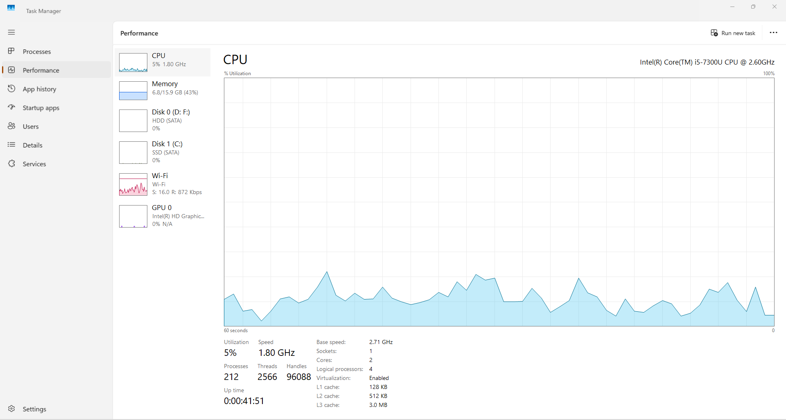
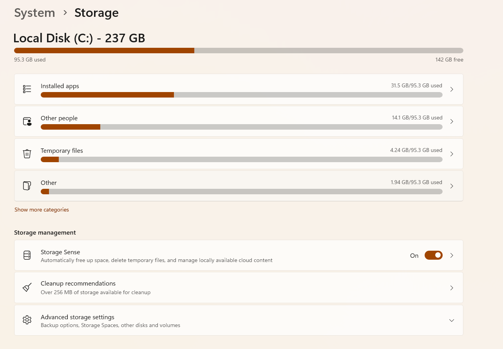
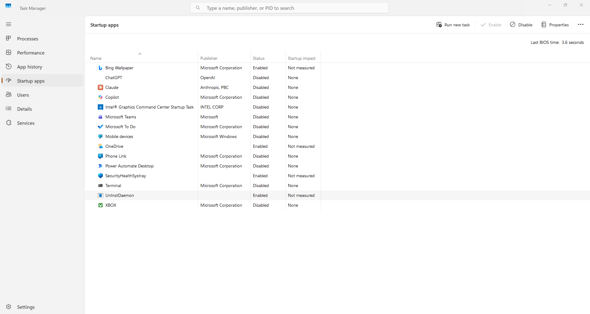
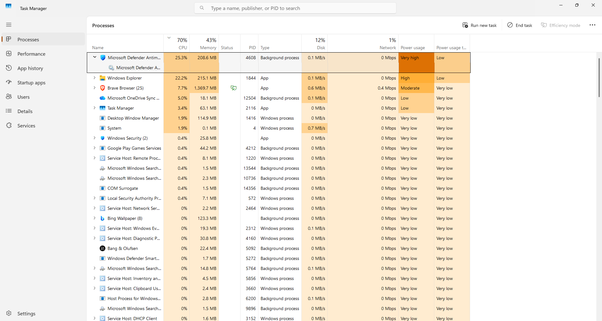
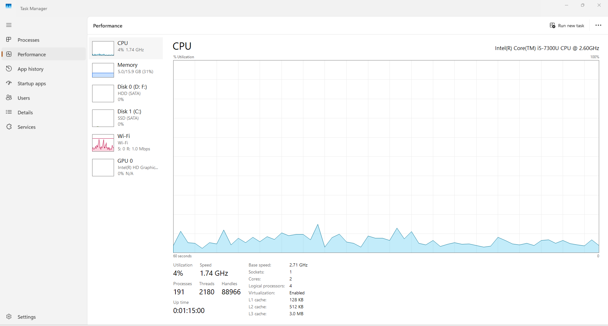
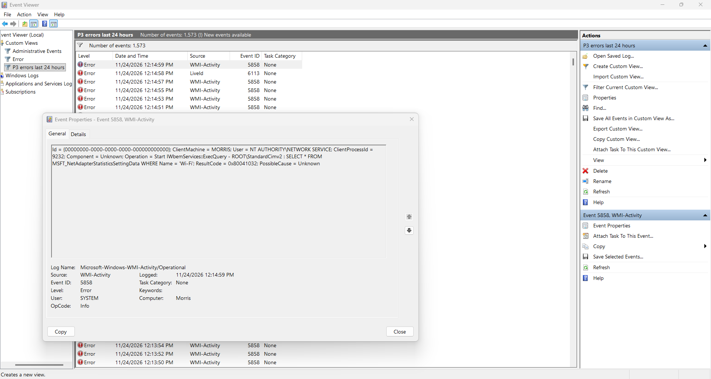
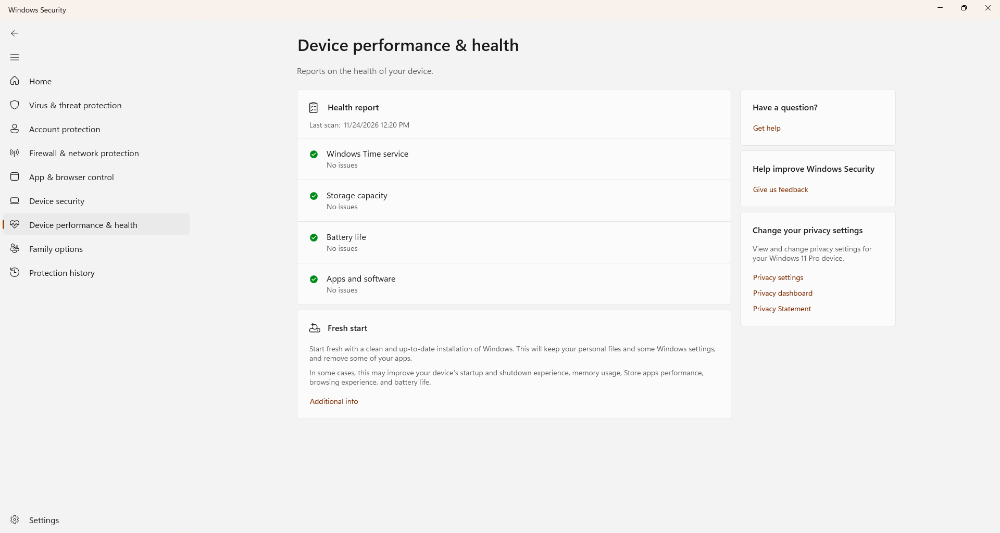

# Project 03: Slow PC and logs

> [!NOTE]
> **Simulated Work.** I investigated a "slow PC" on my own laptop using the graphical tools a help desk uses every day: Task Manager, Storage settings, Startup apps, Event Viewer and Windows Security. I recorded what the PC looks like at rest, what happens during a Windows Security quick scan, what the error log shows, and whether the PC is healthy.
>
> **Skills shown:** reading CPU, memory and disk use, finding which program is using resources, reviewing startup apps, filtering and reading the Windows event log, and checking system and drive health.

## Scenario (Simulated Work)
A user says: "My laptop is slow." I worked through the same checks in order, recorded what I saw at each step, and noted what I could and could not conclude.

## Why this matters
"My PC is slow" is one of the most common support requests. A fixed order of checks finds the cause faster than guessing, and a written record shows what was checked.

## Environment
- OS and edition: Windows 11 Pro
- Tested on: my own laptop (Intel Core i5-7300U, 15.9 GB memory, an SSD for drive C: and a hard disk for D: and F:). No work or client data used.
- Tools used: Task Manager, Settings, Windows Security, Event Viewer and File Explorer. No command line.
- Safety: I only looked and, in the one step that creates load, ran a normal Windows Security quick scan. I deleted and uninstalled nothing.
- Redaction: computer and account names are real and left visible. No IP addresses, MAC addresses or Wi-Fi network names appear in these screenshots, so nothing needed covering.

## The method: look for the cause in this order
1. **What is the PC doing right now?** Check CPU, memory, disk and free space.
2. **Which program is responsible?** Sort the running processes by the busiest resource.
3. **What starts automatically?** Look at the startup apps.
4. **What does the log say?** Look for errors around the time of the problem.
5. **Is the PC itself healthy?** Check Windows' health report and the drive.

---

# Part 1: Baseline (the PC at rest)

## Step 1: Task Manager at rest
- **Action:** pressed `Ctrl+Shift+Esc` to open Task Manager, then opened the **Performance** tab and clicked **CPU**.
- **What it is:** Task Manager is Windows' live view of what the PC is doing. The Performance tab shows graphs for CPU, memory, disk and network.
- **What I expected:** a low CPU figure with a calm graph.
- **What happened:** CPU was at 5%. Memory in use was 6.8 of 15.9 GB (43%). Both disks showed 0% activity. There were 212 processes, and the PC had been running for 41 minutes.

## Step 2: Storage
- **Action:** opened **Settings, System, Storage**.
- **What it is:** shows how much space is used and free on drive C: and what is taking it up.
- **What I expected:** plenty of free space. A nearly full drive can make a PC slow.
- **What happened:** drive C: is 237 GB, with 95.3 GB used and 142 GB free. The largest categories were Installed apps (31.5 GB), Other people (14.1 GB, files belonging to other accounts on this PC) and Temporary files (4.24 GB). Storage Sense is on, and Windows offers over 256 MB of cleanup. I deleted nothing.

## Step 3: Startup apps
- **Action:** in Task Manager, opened **Startup apps**.
- **What it is:** a list of every program that can start when I sign in. **Startup impact** says how much each slows the start.
- **What I expected:** a short list of enabled items.
- **What happened:** the list has 15 apps, of which **4 are enabled**: Bing Wallpaper, OneDrive, SecurityHealthSystray (Windows Security) and UnInstDaemon. The other 11 are disabled. All enabled items show "Not measured" for impact. Last BIOS time is 3.6 seconds.
- **UnInstDaemon:** the publisher is blank in the list. I checked it and it is a Microsoft application. I don't know exactly what it does, so I left it alone.
- **Conclusion:** startup apps are light and are not the cause of slowness on this PC.

---

# Part 2: A slowdown

## Step 4: Start a quick scan and find what is using the CPU
- **Action:** opened **Windows Security, Virus & threat protection** and started a **Quick scan**. While it ran, I opened Task Manager, **Processes**, and clicked the **CPU** column heading to sort the busiest process to the top.
- **What it is:** the Processes tab lists every running program and how much CPU, memory, disk and network each one uses. The figures at the top of each column are totals for the whole PC.
- **What I expected:** a rise in CPU, with the Windows scanning program near the top.
- **What happened:**
  - Total CPU rose to 70% (from 5% at rest), with memory at 43% and disk at 12%.
  - The Microsoft Defender antimalware process (its name is cut off in the list) was at the top with 25.3% CPU and a power usage of "Very high".
  - Next came Windows Explorer (22.2%), Brave Browser (7.7% CPU and 1,369.7 MB of memory) and OneDrive sync (5.0%).
- **Diagnosis:** the load was Windows running a scan, which is a normal job that ends by itself. I did not end it.
- **Note:** Windows Explorer at 22.2% was not investigated as it went back to normal seconds after.

## Step 5: Confirm it returns to normal
- **Action:** after the scan finished, I opened Task Manager, **Performance** again.
- **What I expected:** CPU back to a low level.
- **What happened:** CPU was at 4%. Memory in use was 5.0 of 15.9 GB (31%), lower than before the scan. There were 191 processes, and the PC had been running for 1 hour 15 minutes.
- **Note:** I did not track why memory ended lower than at the start. Programs being closed in between is one possible reason.

---

# Part 3: Logs and health

## Step 6: Read the error log in Event Viewer
- **Action:** opened **Event Viewer** and created a **Custom View** named `P3 errors last 24 hours`, showing Critical and Error events from the last 24 hours. I opened one event to read its details.
- **What it is:** Event Viewer is where Windows records what happened. A custom view is a saved filter so only the events I care about are shown.
- **What I expected:** a few errors.
- **What happened:**
  - The view contained **1,573 events**. The top rows were mostly **WMI-Activity, Event ID 5858**, repeating every few seconds, plus a LiveId event (ID 6113).
  - The event I opened is in the log `Microsoft-Windows-WMI-Activity/Operational`. It says that a request for Wi-Fi adapter statistics failed, with the result code `0x80041032`, the user `NT AUTHORITY\NETWORK SERVICE` and the process ID 9232.
- **What I found out:** Microsoft's support article on this code says `0x80041032` means `WBEM_E_CALL_CANCELLED`: a program asked Windows for management information and released the request before it finished. The article was written for Windows Server 2012 R2 but explains the code. It is widely reported as a frequently logged event.
- **Conclusion:** the same error repeating many times does not by itself show a fault.

## Step 7: Windows Security health report
- **Action:** opened **Windows Security, Device performance & health**.
- **What it is:** a summary of the PC's health.
- **What I expected:** green ticks.
- **What happened:** the report's last scan was 11/24/2026 at 12:20 PM. Windows Time service, Storage capacity, Battery life and Apps and software all show "No issues".

## Step 8: Check the drive for errors
- **Action:** in File Explorer, right-clicked drive **C:**, chose **Properties**, opened the **Tools** tab, and clicked **Check** under Error checking.
- **What it is:** a check of the drive's file system for errors.
- **What I expected:** no errors.
- **What happened:** "Your drive was successfully scanned. Windows successfully scanned the drive. No errors were found."

---

## Expected vs actual
| Stage | Check | Expected | Actual | Evidence |
|---|---|---|---|---|
| Baseline | CPU and memory at rest | Low | CPU 5%, memory 43% | Screenshot |
| Baseline | Free space on C: | Plenty | 142 GB free of 237 GB | Screenshot |
| Baseline | Startup apps | Few enabled | 4 of 15 enabled, impact "Not measured" | Screenshot |
| Slowdown | Total CPU during a quick scan | Rises | 70% | Screenshot |
| Slowdown | Top process by CPU | Windows scanning program | Microsoft Defender antimalware process, 25.3% | Screenshot |
| Slowdown | CPU after the scan | Back to low | 4% | Screenshot |
| Logs | Errors in the last 24 hours | A few | 1,573, mostly WMI-Activity 5858 | Screenshot |
| Health | Windows Security health report | No issues | No issues on all four items | Screenshot |
| Health | Drive error check | No errors | No errors found | Screenshot |

## Problems I hit
None recorded for this task.

## What I could not test or verify
- **One sample:** the CPU figures are single readings, not an average over time.
- **Windows Explorer:** it used 22.2% CPU at the moment of the process screenshot. I did not investigate why as it went back to 0% seconds after
- **Scope:** one laptop, graphical tools only.

## What I learned
- Test in order: what the PC is doing, which program, what starts automatically, what the log says, whether the PC is healthy.
- A busy process is not always a fault. A Windows quick scan is a normal job and ends by itself, so it should not be ended.
- Total figures at the top of Task Manager's columns show how loaded the whole PC is, and the rows show who is responsible.
- A long list of errors in Event Viewer does not always mean something is wrong. The Source and Event ID are what to look up.
- Windows Security's health report and the drive check give a quick all-clear for common causes of slowness.
- Disabling a startup app does not uninstall it, so it is a safe, reversible change.

## Tools and where to find them
| Tool | How to open it | What I used it for |
|---|---|---|
| Task Manager | `Ctrl+Shift+Esc` | CPU, memory and disk use; running processes; startup apps |
| Storage settings | Settings, System, Storage | Used and free space on drive C: |
| Windows Security | Start menu, Windows Security | Quick scan and the Device performance & health report |
| Event Viewer | Start menu, Event Viewer | Custom view of recent errors and their details |
| Drive Properties | File Explorer, This PC, right-click C:, Properties, Tools | Drive error check |

## Evidence checklist
- [x] Screenshots numbered, no spaces in file names, stored in `Attachments/`
- [x] No IP addresses, MAC addresses or Wi-Fi names appear in the screenshots
- [x] Steps without a screenshot, and untested items, recorded honestly
- [x] No problems recorded, and limits of the evidence stated
- [x] Uploaded to GitHub folder
