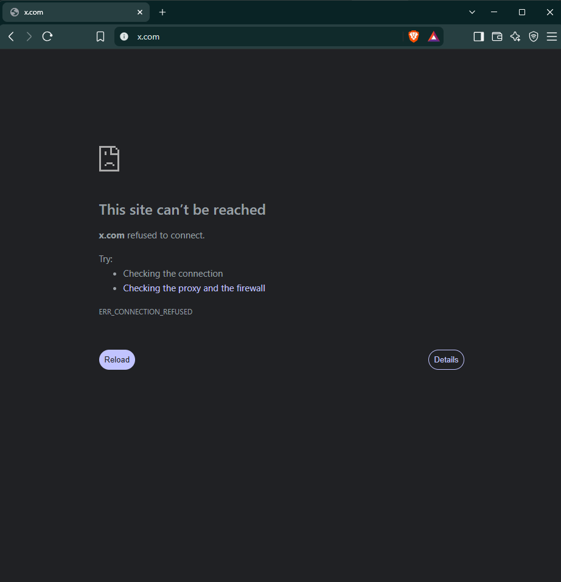

# SIM-001: Block a distracting website on one PC

> [!NOTE]
> **Simulated Work.** Fictional requester. Commands and results are from [Project 00](../00-hosts-file-block/README.md).

| Field | Value |
|---|---|
| Requester | Maya, Reception Supervisor (fictional) |
| Category | Configuration change |
| Priority | Low (no effect on work, convenience request) |
| Status | Resolved |

## Request
"Can you stop people opening X on the reception PC? It takes up too much time. Please don't install anything."

## Questions I would ask
- Is it one PC or all of them? (One.)
- Which sites? (X, which also answers to the older twitter.com name.)
- Can I install software? (No.)
- Does it need to be reversible? (Yes.)

## Diagnosis and approach
The hosts file is built into Windows, needs no software, and is checked before DNS, so it can block a site on a single PC. It can only be saved by an editor running as administrator.

## Actions taken
1. Opened Notepad++ as administrator and opened `C:\Windows\System32\drivers\etc\hosts` (file type filter set to "All types", because the file has no extension).
2. Added four lines that send each name to `127.0.0.1`, the PC itself:
   ```text
   127.0.0.1 x.com
   127.0.0.1 www.x.com
   127.0.0.1 twitter.com
   127.0.0.1 www.twitter.com
   ```
3. Saved the file, then ran `ipconfig /flushdns` in PowerShell as administrator. Result: "Successfully flushed the DNS Resolver Cache."

## Verification
- `x.com`, `www.x.com`, `twitter.com` and `www.twitter.com` in Brave all showed `ERR_CONNECTION_REFUSED`.
- `x.com` in Microsoft Edge and Google Chrome showed the same error.



## Rollback
Put `#` at the start of each of the four lines, save, and run `ipconfig /flushdns`. I did this and X loaded again in Brave.

## Limits
- The block works on this one PC only. Other devices and the X mobile app are not affected.
- A user with administrator rights could edit the file and undo it.
- I have no screenshot of X loading before the block was first added.

## Resolution
X is blocked in all three browsers on the PC, with a documented way to undo it. Ticket closed.

**Full write-up:** [Project 00](../00-hosts-file-block/README.md)
