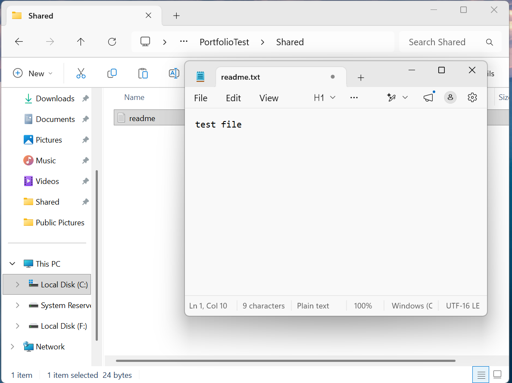

# SIM-002: New starter needs access to a shared folder

> [!NOTE]
> **Simulated Work.** Fictional requester. Commands and results are from [Project 01](../01-windows-accounts-permissions/README.md). The new starter's account is called `TestUser` in my lab.

| Field | Value |
|---|---|
| Requester | Daniel, Team Lead (fictional) |
| Category | Access and permissions |
| Priority | Medium (new-starter request with a start date) |
| Status | Resolved |

## Request
"Our new intern starts Monday. She needs to see the files in the Shared folder but must not change anything. Later she'll need to add her own files."

## Questions I would ask
- Which folder, and who else can open it now?
- Should she be a standard user, not an administrator? (Yes.)
- Read only first, then more access later?

## Actions taken
1. Created a standard local account: `net user TestUser * /add`. The `*` makes Windows ask for the password with hidden typing. Checked the groups: the account was in Users and not in Administrators.
2. Created `C:\PortfolioTest\Shared` with a test file, `readme.txt`, and gave only Administrators and SYSTEM full control with `icacls`.
3. Removed inherited permissions with `/inheritance:r` (see "Problem found").
4. Confirmed which account I was testing as with `whoami` (`morris\testuser`). Before any access was granted, the folder was blocked.
5. Granted read-only access: `icacls 'C:\PortfolioTest\Shared' /grant 'TestUser:(OI)(CI)(R)'`
6. When she needed to add files, changed it to Modify: `icacls 'C:\PortfolioTest\Shared' /grant:r 'TestUser:(OI)(CI)(M)'`

## Problem found
The folder was open to ordinary users at first. `icacls` showed inherited entries (`BUILTIN\Users:(I)(OI)(CI)(RX)` and `NT AUTHORITY\Authenticated Users:(I)(M)`), because a new folder inherits its parent's permissions. Running `/inheritance:r` removed them, and the account was then blocked, as intended.

## Verification (tested as the new account)
| Stage | Result |
|---|---|
| Before any grant | Blocked |
| After Read | Opened the folder and `readme.txt`; creating a new file was denied |
| After Modify | Created a new folder inside `Shared` |

## Cleanup
Deleted the test account and folder afterwards (`net user TestUser /delete` and `Remove-Item -Recurse -Force`), and confirmed both were gone.

## Limits
- Saving an edit to an existing file under Read-only access was not tested.
- Local accounts on one PC only. I did not test domain or Active Directory accounts.

## Resolution
The new starter can read the folder, and later add files, without administrator rights. Ticket closed.

**Full write-up:** [Project 01](../01-windows-accounts-permissions/README.md)
