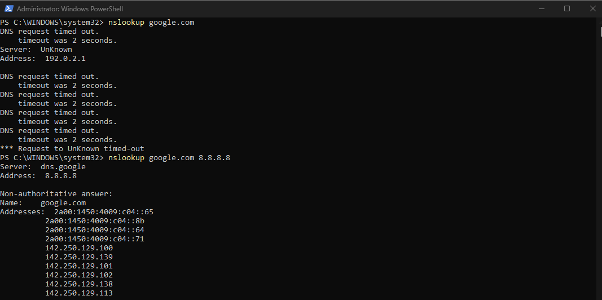

# SIM-003: "I can't open any website"

> [!NOTE]
> **Simulated Work.** Fictional requester. The fault was created on purpose on my own laptop. Commands and results are from [Project 02](../02-network-troubleshooting/README.md).

| Field | Value |
|---|---|
| Requester | Tunde, Sales Assistant (fictional) |
| Category | Network |
| Priority | High (the user cannot work) |
| Status | Resolved |

## Request
"I can't open any website, but my Wi-Fi shows connected."

## Questions I would ask
- Is it every site or one? (Every site.)
- Did anything change recently?
- Do other people have the same problem?

## Diagnosis (testing from the bottom up)
| Test | Result | What it tells me |
|---|---|---|
| `ping 8.8.8.8` | Replies, 0% loss | The internet is reachable by address |
| `ping google.com` | "Ping request could not find host google.com" | Names are not being turned into addresses |
| `nslookup google.com` | Timed out; the server shown was `192.0.2.1` | The DNS server in use does not answer |
| `nslookup google.com 8.8.8.8` | Answered | Another DNS server works, so the internet is fine |

**Cause:** the PC was pointed at a DNS server that does not exist, so names failed while addresses worked.



## Resolution
```powershell
Set-DnsClientServerAddress -InterfaceAlias "Wi-Fi" -ResetServerAddresses
ipconfig /flushdns
```
The first command hands DNS control back to the network (automatic). The second clears old lookups.

## Verification
`ping google.com` resolved to an address and replied with 0% loss. `Get-DnsClientServerAddress` then listed the DNS server the network assigned.

## Limits
- I did not record how a browser behaved during the fault. Some browsers use their own secure DNS and might still load pages.
- The command that set the broken DNS server is not in a screenshot. The `192.0.2.1` server shown by `nslookup` confirms it took effect.
- I switched networks between my baseline and this fix, so the DNS address afterwards is not the same as in the baseline.

**Full write-up:** [Project 02](../02-network-troubleshooting/README.md)
