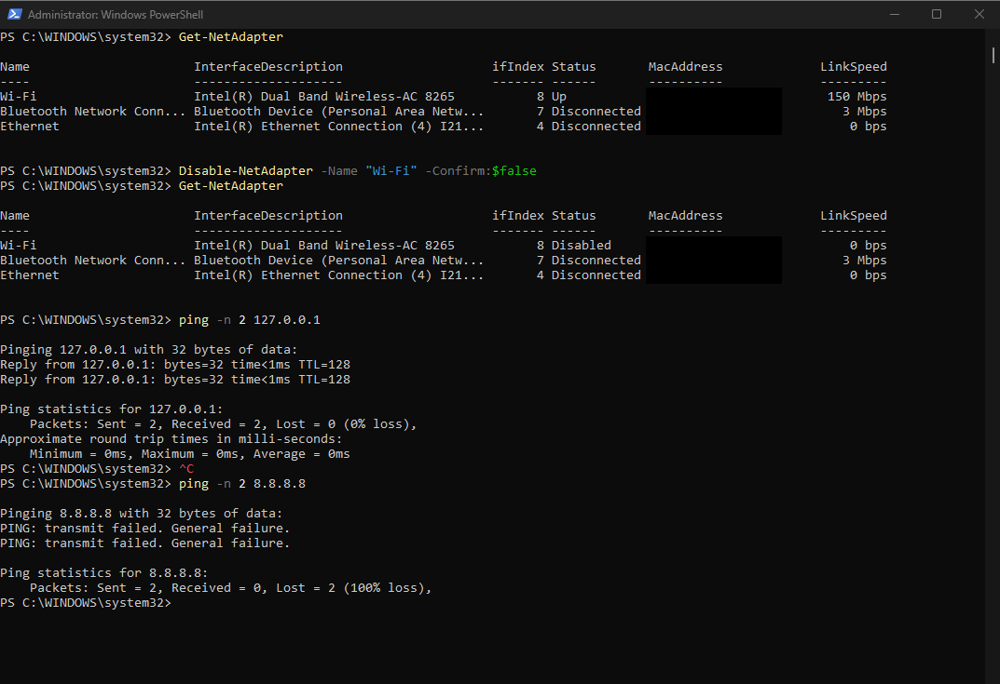

# SIM-004: "My laptop says there is no network"

> [!NOTE]
> **Simulated Work.** Fictional requester. The fault was created on purpose on my own laptop. Commands and results are from [Project 02](../02-network-troubleshooting/README.md).

| Field | Value |
|---|---|
| Requester | Grace, Accounts Assistant (fictional) |
| Category | Network |
| Priority | High (the user cannot work) |
| Status | Resolved |

## Request
"My laptop says there is no network at all."

## Questions I would ask
- Does it say no network on Wi-Fi only, or on a cable too?
- Did the Wi-Fi switch or a function key get pressed?
- Does the laptop find any Wi-Fi networks?

## Diagnosis (testing from the bottom up)
| Test | Result | What it tells me |
|---|---|---|
| `ping 127.0.0.1` | Replies, 0% loss | The network software on the laptop works |
| `ping 8.8.8.8` | "PING: transmit failed. General failure." and 100% loss | Nothing is getting out |
| `Get-NetAdapter` | Wi-Fi status `Disabled` (0 bps) | The Wi-Fi adapter itself is switched off |

**Cause:** the Wi-Fi adapter was disabled.



## Resolution
```powershell
Enable-NetAdapter -Name "Wi-Fi"
```
This switches the adapter back on.

## Verification
Straight after enabling, `Get-NetAdapter` still showed Wi-Fi as `Disconnected`. After a short wait it showed `Up` at 150 Mbps, and `ping 8.8.8.8` replied with 0% loss. The first reply was slow (664 ms), probably because the connection had only just come back.

## Limits
- This was a deliberate fault on one laptop with one Wi-Fi adapter. On a real ticket I would also check the physical Wi-Fi switch and the driver.
- I did not record which Wi-Fi network the laptop reconnected to.

**Full write-up:** [Project 02](../02-network-troubleshooting/README.md)
