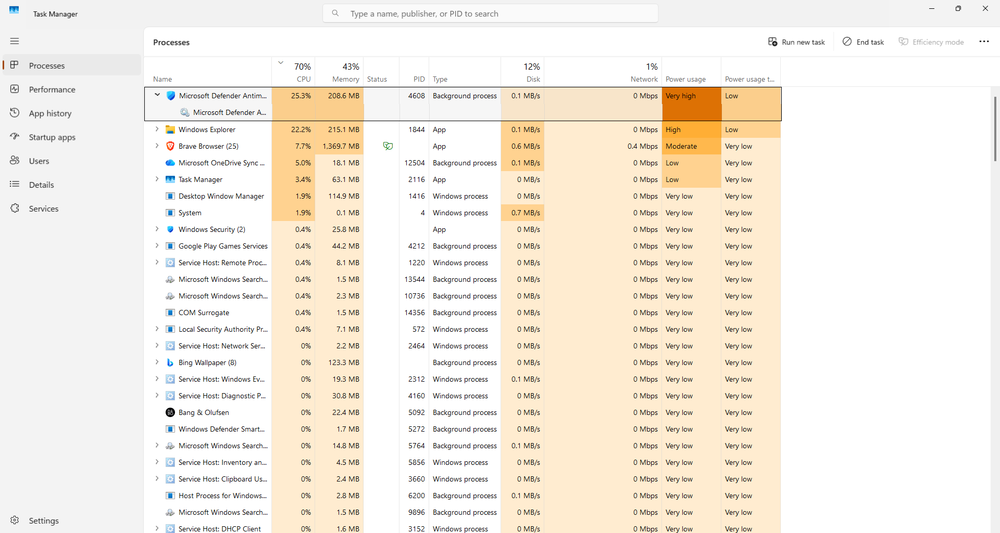

# SIM-005: "My laptop is slow"

> [!NOTE]
> **Simulated Work.** Fictional requester. I checked my own laptop with the graphical tools from [Project 03](../03-slow-pc-and-logs/README.md). No fault was created on purpose; the slowdown came from a normal Windows scan I started myself.

| Field | Value |
|---|---|
| Requester | Daniel, Sales Coordinator (fictional) |
| Category | Performance |
| Priority | Medium (the user can work, but slowly) |
| Status | Resolved (cause found and explained, no fix needed) |

## Request
"My laptop is slow."

## Questions I would ask
- Is it slow all the time, or only at certain times?
- Which program is slow, or is the whole PC slow?
- Did anything change recently (new software, an update)?

## Diagnosis (checking in a fixed order)
| Check | Result | What it tells me |
|---|---|---|
| Task Manager, Performance, at rest | CPU 5%, memory 43%, disks 0% | The PC is not overloaded when idle |
| Storage settings | 142 GB free of 237 GB on C: | Free space is not the problem |
| Startup apps | 4 of 15 enabled | Startup is light, not the cause |
| Task Manager, Processes, during a quick scan | Total CPU 70%. Microsoft Defender antimalware process at the top (25.3%) | The load was a Windows scan |
| Task Manager, after the scan | CPU 4% | It returned to normal by itself |
| Event Viewer, errors in the last 24 hours | 1,573 events, mostly WMI-Activity 5858 repeating | A long error list is not a fault by itself; I looked up the code |
| Windows Security health report | No issues on all four items | No common cause of slowness found |
| Drive error check on C: | No errors found | The drive file system is healthy |

**Cause:** the slowness matched a Windows quick scan using the CPU. It is normal and ends on its own.

## Resolution
I changed nothing. I did not end the scan. I would tell the user that the PC is slow while a scan runs and returns to normal when it finishes.

## Verification
After the scan finished, CPU was back to 4% in Task Manager.

## Limits
- CPU figures are single readings, not an average over time.
- Windows Explorer used 22.2% CPU at one moment and I did not investigate it.
- I looked up the repeated WMI error code but did not trace which program causes it.
- This is my own laptop. On a real ticket I would first find out when the user sees the slowness, and it might not be a scan.

**Full write-up:** [Project 03](../03-slow-pc-and-logs/README.md)
